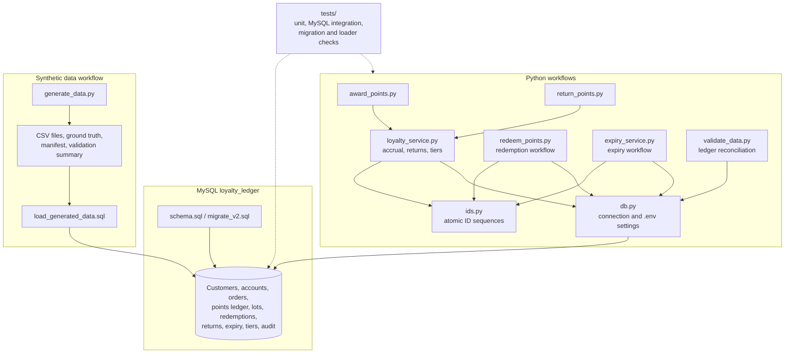

# Loyalty Ledger

A Python and MySQL application for earning, redeeming, reversing, and expiring loyalty points. Every points change is recorded in an append-only transaction ledger; `loyalty_accounts.current_points` is a cached balance that can be checked against the ledger.

The project includes database-backed workflows, a deterministic synthetic-data generator with labelled edge cases, a reconciliation command, automated scenario tests, setup guidance, and a data dictionary. The small and full synthetic datasets include machine-checked invariants and SHA-256 manifests. MySQL reconciliation results are recorded in [`reports/validation_summary.json`](reports/validation_summary.json). This is a local project and has not been deployed as a hosted service.

## Architecture



The command-line scripts call the Python workflows, which use `db.py` to connect to MySQL. `ids.py` allocates collision-safe business IDs. The generator is a separate path that creates synthetic CSV data and a loader script; `validate_data.py` checks ledger and lifecycle consistency. Automated database tests use temporary schemas.

## Requirements

- Python 3.11 or newer
- MySQL 8.0.29 or newer
- A local MySQL database and a user allowed to create and update tables

## Setup

From PowerShell, open the project directory and create the virtual environment:

```powershell
cd <path-to-project>\loyalty-ledger
python -m venv .venv
.venv\Scripts\Activate.ps1
python -m pip install -r requirements.txt
```

Copy `.env.example` to `.env`, then edit `.env` with the local MySQL connection settings. Keep `.env` private; it is excluded by `.gitignore`. Never commit or publish `.env`, screenshots containing credentials, or real customer data. Use a separate local database account for this project when possible.

For a new database, start the MySQL client from the project root:

```powershell
mysql -u root -p
```

At the `mysql>` prompt, run:

```sql
SOURCE sql/schema.sql;
SOURCE sql/seed_demo.sql;
```

If `mysql` is not on `PATH` on Windows, launch it by its installed path from PowerShell, for example `& "C:\Program Files\MySQL\MySQL Server 8.0\bin\mysql.exe" -u root -p`, then use the `SOURCE` commands above. The path may differ by installation.

### Existing starter database

Back up an existing database before upgrading it. Run `sql/migrate_v2.sql` once against the starter database; do not run `schema.sql` over it. Then run `sql/reconcile_opening_balances.sql` to preserve any pre-existing account balance that was not represented in the original transaction ledger. Run `sql/migrate_v3.sql` after the v2 upgrade to add effective tier rules, recorded accrual metadata, reversal-to-lot allocations, and microsecond event timestamps. The v3 migration is repeat-safe; the v2 migration targets the original starter schema and should not be rerun or used on a fresh v2 database.

## Run the workflows

Award points for a completed order. The demo order earns five points at the Basic tier:

```powershell
python src/award_points.py ORD-2026-000001
```

The command refuses to award the same order twice. New points are recorded in `points_transactions` and a dated `point_lots` row is created.

Redeem points interactively:

```powershell
python src/redeem_points.py
```

The service checks the balance under a row lock, consumes the oldest-expiring lots first, records a negative ledger transaction, and updates the account balance in one database transaction. Concurrent attempts for one account are serialized by MySQL.

To record a return, first create a requested return row in MySQL. For example:

```sql
INSERT INTO order_returns
    (return_id, order_id, return_date, refund_amount, return_status)
VALUES
    ('RET-2026-000001', 'ORD-2026-000001', NOW(), 200.00, 'REQUESTED');
```

Then complete it:

```powershell
python src/return_points.py RET-2026-000001
```

Earned points are reversed proportionally to the refund amount. Reversals link to the original accrual. If reversed points have already been spent, the ledger can show a negative net balance until later earnings offset it; redemption remains blocked while the balance is negative.

Process due point lots once per run:

```powershell
python src/expiry_service.py
```

Each expired lot receives one expiry transaction and one batch detail record. The lot is set to zero in the same database transaction, making a repeat run idempotent.

Review ledger and lifecycle reconciliation:

```powershell
python src/validate_data.py
```

The command reports account-to-ledger mismatches, account-to-lot mismatches, missing accrual lots, excessive refunds, repeated accruals, and lots that should already be expired.

## Run automated tests

From the project root with the virtual environment active, run:

```powershell
python -m unittest discover -s tests -v
```

The suite contains 32 tests: unit tests, deterministic generator checks, MySQL workflow and concurrency checks, CSV loader integration, command-line success and failure checks, and migration tests from a synthetic legacy schema through v3. The database tests require the local MySQL credentials in `.env` to have permission to create and drop databases. They create uniquely named temporary databases, run against those databases, and drop them when the test run finishes; they do not use the configured `loyalty_ledger` database for test records. The CSV loader test temporarily enables MySQL `local_infile` only when necessary, then restores the server's original setting.

See [`docs/test_plan.md`](docs/test_plan.md) for the requirement-to-test map and latest results.

## Generate synthetic data

The generator uses Python's standard library and defaults to the requested 20,000 customers, 100,000 orders, and 300,000 point transactions. It uses seed `20261022`, deterministic business IDs, a fixed as-of date, and writes a SHA-256 source manifest. Baseline rows are reconciled before output; labelled decision fixtures are written separately so ground truth is not mixed into input tables.

Start with a small dataset in a separate folder:

```powershell
python src/generate_data.py --customers 20 --orders 100 --seed 20261022 --output data/generated_small
```

Generate the full requested volume with:

```powershell
python src/generate_data.py --customers 20000 --orders 100000 --seed 20261022
```

Orders must be an even number of at least four. The output contains CSV files, `edge_cases.json`, `ground_truth.csv`, a MySQL `LOAD DATA LOCAL INFILE` script, `validation_summary.json`, and `manifest.json`. Audit rows cover accruals, redemptions, returns, expiries, and tier changes. The loader keeps MySQL foreign-key enforcement enabled and relies on the parent-first table order. To load generated rows, first initialize an empty database with `sql/schema.sql`. Do not load a generated dataset on top of the demo seed rows. Start MySQL with local infile enabled:

```powershell
mysql --local-infile=1 -u root -p
```

Then at the `mysql>` prompt run `SOURCE data/generated/load_generated_data.sql;` from the project root. The client flag enables local infile on the client; the MySQL server must also have `local_infile` enabled. Check with `SHOW GLOBAL VARIABLES LIKE 'local_infile';`. If it is off, a MySQL administrator must enable it for the import and restore the original value afterward.

## Main entities

`customers` and `loyalty_accounts` are one-to-one. Customers have orders and points transactions. Orders have order lines, returns, and an optional accrual. Accruals create point lots; redemptions consume lots through `lot_consumptions`; expiry batches process due lots. Tier changes are recorded in `account_tier_history`, and significant business events are captured in `audit_events`.

Customer business IDs use `LOY-000001`; transaction IDs use `PTS-2026-########`. Redemption, expiry, return, and order IDs use zero-padded counters. Counters are stored in `id_sequences` and increment atomically in MySQL.

## Business assumptions

- The project uses INR amounts and one point per ₹100 of eligible net spend at the Basic tier. Higher tiers use the rates configured in `tiers`.
- Eligible spend comes from eligible order lines after discounts. Orders without lines use `orders.total_amount` as a compatibility fallback.
- New accruals expire after 365 days by default. The duration can be changed with `--expiry-days` on the award command.
- Refunds are allocated to eligible spend in proportion to the original eligible share of the order. A refund completed before accrual reduces the eventual eligible spend; a refund after accrual creates only the incremental point reversal. Whole-point amounts round down.
- Point lots are usable from `earned_at` up to, but not including, `expires_at`. Timestamps are stored and compared in UTC; the expiry command's date argument means the end of that UTC date.
- Returns after expiry offset points already expired before creating a reversal. If the customer spent the remaining earned points, the reversal can create an audited negative balance.
- The effective tier rule and its rate are stored on each accrual. Tier changes use event-time qualifying spend after completed refunds.
- A rule or exception is persisted as a transaction or lifecycle record; generated ground-truth labels will be kept separate from input data.

## AI use

I used AI assistance for troubleshooting, implementation guidance, code review, test coverage, and documentation. The disclosure and historical prompt notes are in [`docs/ai_usage.md`](docs/ai_usage.md). The recorded prompts are:

1. “What’s next?”
2. “Why keep a points ledger?”
3. “How do I confirm the database?”
4. “How do point lots work?”
5. “Did my change break anything?”
6. “How are duplicate points prevented?”
7. “Is the data ready to load?”
8. “What if returned points were spent?”
9. “Is my test data valid?”
10. “How are loyalty tiers assigned?”
11. “How are points calculated?”
12. “When do points expire?”
13. “How are partial returns handled?”
14. “Why use database transactions?”
15. “What does this test result mean?”
16. “How should I explain the architecture?”

## Validation and candidate submission

Before submission, review and understand the implementation and ensure the prompt-history record covers the prompts required by the submission guidelines. The history in [`docs/ai_usage.md`](docs/ai_usage.md) records the 16 prompts provided by the project owner. Do not publish local credentials or private data.

The automated suite and recorded data checks cover the implemented business rules and edge cases, but they do not prove a hosted deployment or replace the project owner's code review. Review the code and be prepared to explain the transaction, locking, idempotency, and data-generation decisions before submitting.
